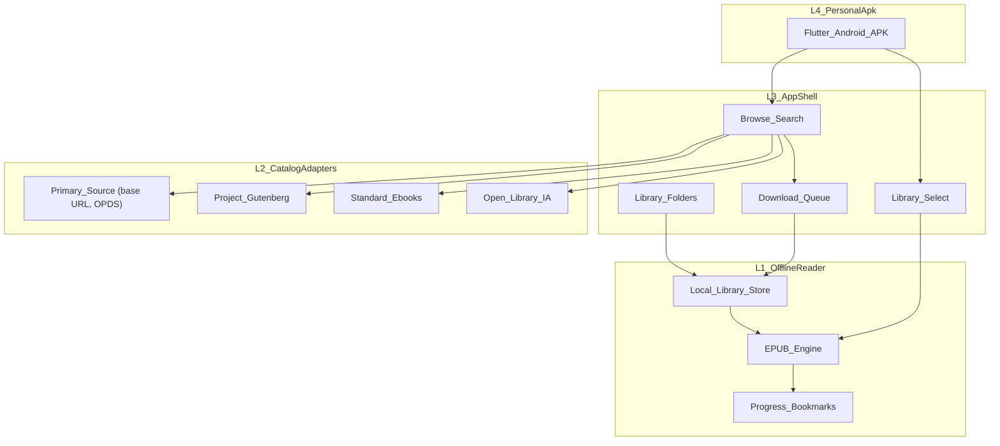

# Folio architecture (outer to inner)

Folio is a private, open-source Kindle-style reader. It ships as a **personal sideloaded Android APK** built with **Flutter**. It is not published to the Play Store and the APK is not distributed.

## Layer model



### L4: Android app (personal sideloaded APK)

- Flutter Android target with Material 3 UI. No account of any kind.
- Built with `flutter build apk --release`, signed with a personal keystore kept outside the repo (`android/key.properties` and `*.jks` are gitignored), and installed with `adb install` or by copying the file to the phone.
- Permissions: network for catalogs. Downloaded books live in app-private storage.

### L3: Shell (read, select, manage)

- **Library**: grid of books with cover, title and author. Tap to read and resume from the last position. Long-press to remove.
- **Browse**: one tab per catalog source, with search, feed navigation and a download action.
- **Library folders**: in Settings, pick one or more phone folders (for example `Download/Books`) with the Android system folder picker (Storage Access Framework). The app keeps a persisted permission for each folder.
  - Each folder is scanned recursively for `.epub` files, which are indexed **in place** with no copy. Title, author and cover are cached in the database.
  - Rescans run on app launch and on pull-to-refresh. New files appear, and books whose files are gone are removed from the library.
  - Opening a folder book copies it into a temporary cache while the reader has it open.
  - Removing a folder drops its books from the library and leaves the files on disk untouched.
- **Single-file import**: open one EPUB from a file manager or the share sheet, or with the import button. The file is copied into app-private storage.
- **Download queue**: progress, retry and cancel. Finished downloads are added to the library.

### L2: Catalog adapters

Every source implements one interface:

```dart
abstract class CatalogSource {
  String get id;
  String get name;
  Future<CatalogPage> root();
  Future<CatalogPage> open(Uri feedUrl);
  Future<CatalogPage> search(String query);
  Future<Uri?> resolveDownloadUrl(CatalogEntry entry);
}
```

Downloads go through one shared downloader (`downloadToFile`).

- **Primary source slot**: a configurable `primaryBaseUrl`, shown first in Browse. The default is the placeholder `https://example.invalid/opds`; until a real URL is set in Settings, the tab shows "No primary source configured." It speaks standard OPDS 1.2 (Atom feeds, OpenSearch, acquisition links) only. It is a generic catalog client; no site-specific scrapers are written. The URL lives in app settings, not in the repo.
- **Extra built-in sources** (secondary tabs):
  - Project Gutenberg (OPDS)
  - Standard Ebooks (OPDS)
  - Open Library / Internet Archive (public-domain and openly licensed EPUBs only)

The primary slot, Gutenberg and Standard Ebooks share one `OpdsCatalog` implementation. Open Library has its own small adapter.

### L1: Core offline reader

- SQLite metadata store (sqflite) plus EPUB files on disk.
- EPUB rendering in a WebView running a bundled reader page based on foliate-js (MIT), loaded from app assets so it works with no network.
- Reading features: paginated view, font size, themes (light, sepia, dark), last position and bookmarks.
- No network access is needed once a book is local.

## Repo shape

```
apps/folio_android/     Flutter app (L3 + L4 wiring)
packages/folio_catalog/ L2 catalog adapters (pure Dart)
packages/folio_core/    L1 store, EPUB metadata, reader bridge
docs/plan.md            this document
```

## Build order

1. Scaffold the Flutter Android app with a library, browse and reader navigation shell.
2. Local import and offline reader: open a picked EPUB offline.
3. Library shell and library folders: pick folders, scan, index in place, list, open and resume.
4. Generic OPDS adapter and primary source slot, tested against Project Gutenberg.
5. Extra sources: Standard Ebooks and Open Library tabs.
6. Reader polish (themes, bookmarks) and a signed release APK for personal install.

## Non-goals for v1

- Play Store publishing or any distribution of the APK.
- Desktop and iOS (Flutter keeps the door open).
- Calibre-style conversion, KOReader-level e-ink tuning, sync services.
- Site-specific scrapers for any download site.

## First milestone

- Install the Flutter Android build.
- Point Folio at a phone folder of EPUBs and see them in Library.
- Read a book fully offline with progress saved.
